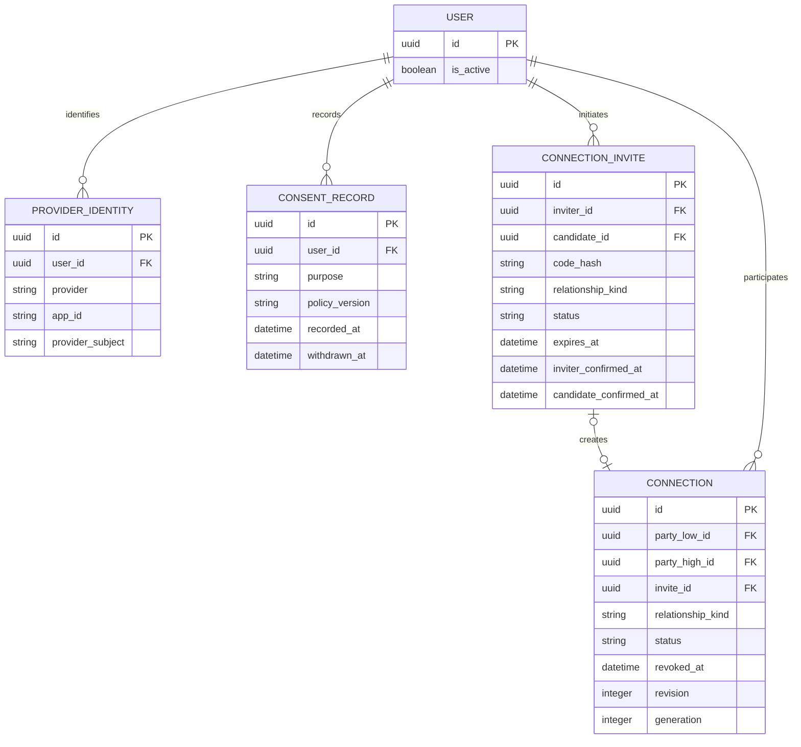
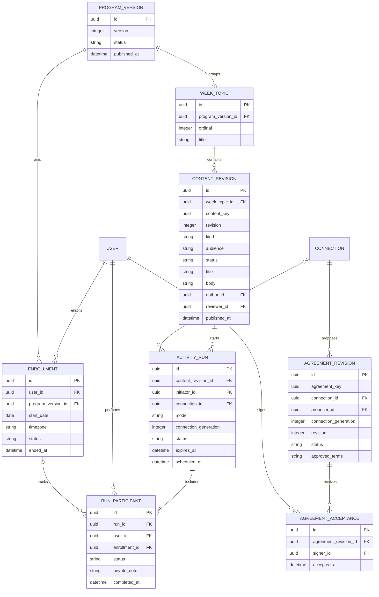
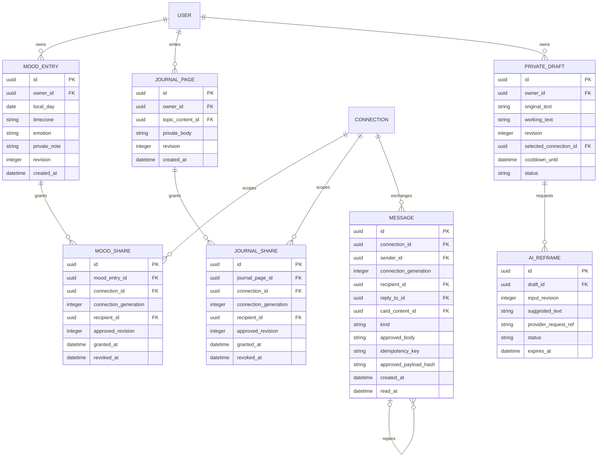
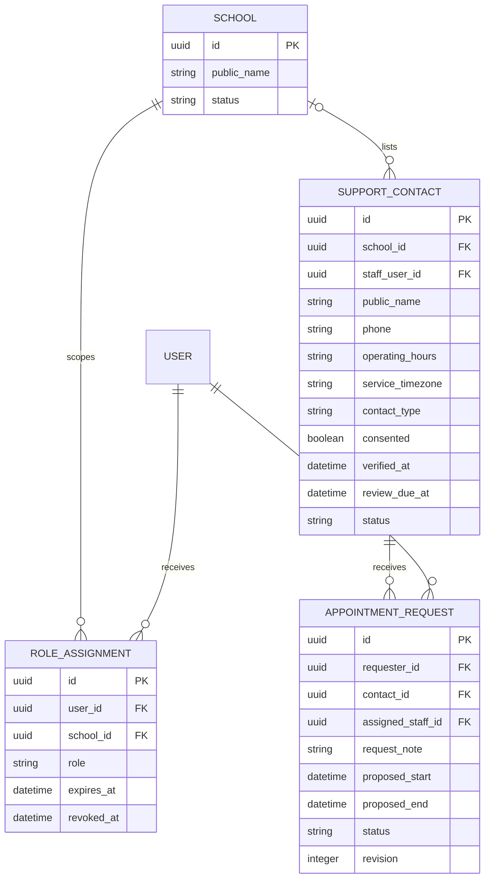
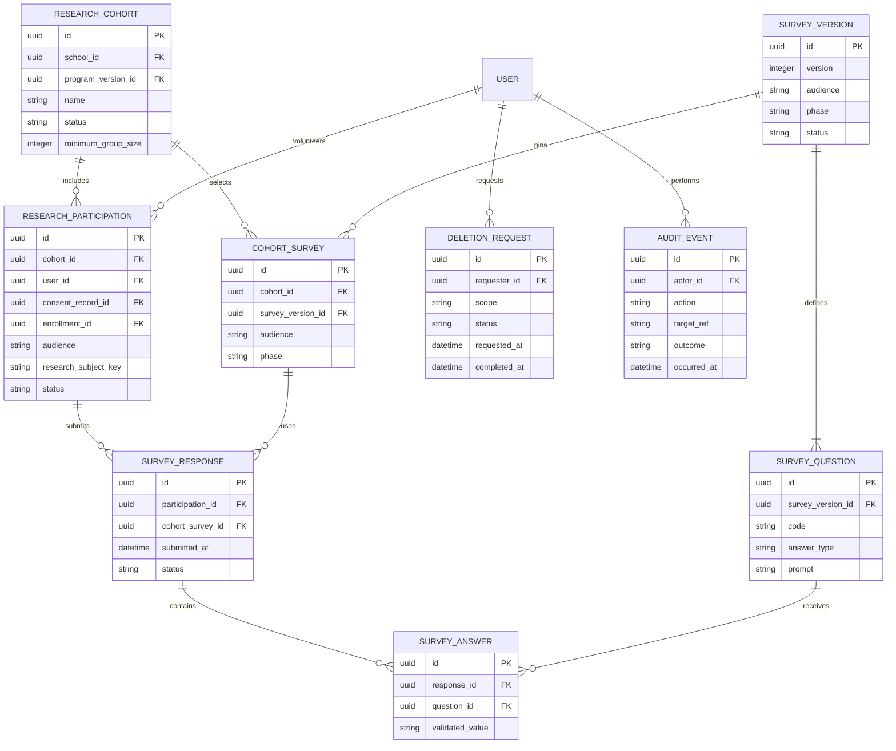

# ERD và hợp đồng dữ liệu đề xuất

Thiết kế logic cho chương trình 4 tuần và các tính năng liên quan, dùng Django + MySQL/InnoDB. Ngoài User UUID ở accounts, các entity dưới đây chưa có model/migration. Không chạy sơ đồ như schema đã hoàn tất. US-004 cần chốt API/model với US sở hữu trước migration.

Mục lục: [quy ước](#quy-ước), [định danh](#định-danh-và-kết-nối), [chương trình](#chương-trình-và-thỏa-ước), [riêng tư](#dữ-liệu-riêng-và-hộp-thư), [hỗ trợ](#hỗ-trợ), [nghiên cứu](#nghiên-cứu-và-vận-hành), [ràng buộc](#ràng-buộc-và-chỉ-mục), [vòng đời](#quyền-và-vòng-đời), [bao phủ](#bao-phủ-tính-năng).

## Quy ước

PK UUID, UTC timestamps; ngày lịch có timezone để tính tuần/mood. FK thật, không GenericForeignKey để quyết định quyền chia sẻ. Các sơ đồ chia theo miền; cùng tên entity là cùng bảng. PK/FK trong sơ đồ là logic, kiểu enum/nullable được chốt ở serializer/migration. Các FK trỏ User nhiều vai trò chỉ vẽ một đường đại diện; bảng ràng buộc nêu quyền thực tế.

State/revision/created_at không được client tùy ý ghi. JSON chỉ cho snapshot có schema và giới hạn, không thay các FK/constraint quan trọng. Không thêm “family_id = quyền đọc tất cả”. Một người có nhiều kết nối, tối thiểu hóa thông tin học sinh/trường. Snapshot public content được version hóa; draft giáo trình không hiển thị cho người dùng.

## Định danh và kết nối

candidate_id có thể null trước khi người nhận nhận mã; khi claim phải gắn đúng actor đã xác minh, rồi inviter xác nhận người đó. Chỉ tạo active Connection khi hai xác nhận đúng hai actor trước expires_at. Loại primary/backup thể hiện quan hệ sử dụng, không grant. Thu hồi connection không xóa user hay toàn bộ consent; consent tham gia nghiên cứu khác consent sử dụng AI/kết nối.

## Chương trình và thỏa ước

CONTENT_REVISION.kind: activity/lesson/emotion_card/quick_reply/paper_guide/guidance. week_topic_id nullable cho thẻ/phản hồi toàn chương trình; các FK chưa vẽ: author/reviewer -> User. public payload loại author nội bộ không cần thiết. Nội dung chương trình đã published bất biến; sửa tạo revision/program version mới. Lượt tham gia pin version, không âm thầm đổi hoạt động đã nhận. ProgramVersion chỉ published khi đủ 4 WEEK_TOPIC ordinal 1..4 và nội dung thiết yếu được duyệt.

Run riêng một participant; run chung đúng hai bên connection. enrollment_id nullable để làm hoạt động không cần đăng ký giáo trình; nếu có phải của participant và đúng program version. Progress suy từ participant, không thêm bảng progress trùng lặp. private_note không nằm trong joint serializer.

Agreement dùng agreement_key nhóm các revision; acceptance gắn revision, không chỉ agreement_key. confirmed khi đủ hai signer của connection. Xem [luồng thỏa ước](../product/four-week-flow.md#thỏa-ước).

## Dữ liệu riêng và hộp thư

Draft -> Message có liên hệ nghiệp vụ nhưng không FK để API nhận tin có thể lần ngược đến original. Nếu cần truy vết retry, dùng mapping riêng owner-only, không serialize cho recipient. FK topic/card -> ContentRevision; chỉ revision published. Message.kind text/emotion_card/journal_reply/mood_reply/listening_signal/quick_reply. Tín hiệu chỉ chứa nhu cầu đã duyệt theo schema; không tự nhúng nội dung private.

Grant chỉ một mục, một recipient và connection còn active; owner phải một bên và recipient bên kia. approved_revision ràng buộc phiên bản chủ động chia sẻ. Sửa mục đang chia sẻ phải thu hồi grant hoặc yêu cầu chủ động chia sẻ lại revision mới; không tự lộ sửa đổi. Trong MVP không giữ phiên bản cũ cho grant đọc, nên mismatch revision trả “không còn được chia sẻ”, không nội dung mới.

Connection.generation tăng khi kết nối lại bằng lời mời mới; revision dùng cho optimistic concurrency và có thể tăng ở cập nhật khác. Message, grant, joint run và agreement lưu connection_generation lúc tạo. Quyền đọc/gửi chung kiểm tra generation hiện tại; reconnect không làm sống lại grant/tâm sự lịch sử hoặc run cũ. Unlink vẫn thu hồi mọi grant active trong transaction/ledger. Sender được xem bản lời mình đã gửi theo policy riêng; generation không cấp quyền xem dữ liệu bên kia.

Reply cho shared item cần FK nullable cụ thể journal_share_id/mood_share_id trên Message (không vẽ để giữ sơ đồ dễ đọc). Không copy body gốc vào reply; đọc context phải qua grant hiện hành, sau revoke không trả context/body mục riêng. Reply body do chính người trả lời duyệt là message riêng với ACL của message.

## Hỗ trợ

contact_type school/help tách trang trợ giúp với tín hiệu thông thường. Staff FK nullable: số điện thoại được duyệt vẫn hiển thị nhưng không nhận request in-app khi không có operator. school_id nullable cho đầu mối công khai khác. staff scope không cho đọc mọi học sinh thuộc trường. Appointment note chỉ requester và assigned staff; admin danh bạ không mặc định đọc note. Listening signal dùng Message, backup dùng Connection; không có bảng auto-escalation.

## Nghiên cứu và vận hành

FK consent_record -> ConsentRecord, phải đúng user/purpose/version còn hiệu lực. research_subject_key là pseudonym, không tự biến raw dữ liệu thành ẩn danh. Mapping user/key không cung cấp cho nhà nghiên cứu. Report API chỉ aggregate đã bỏ nhận diện/suppression, không join journal/mood/messages/AI. Không public raw answer, free text hoặc participation key; khảo sát có free text phải cân nhắc tái nhận diện trước chốt US-004/040.

Cohort.school_id xác định scope báo cáo; null là scope hệ thống chỉ cho capability toàn hệ thống được cấp rõ, không cho mọi staff. Cohort.program_version_id pin giáo trình của nghiên cứu. Participation.enrollment_id nullable (khảo sát không bắt buộc đăng ký giáo trình); nếu có phải cùng user/program version. Chỉ tính metadata chương trình của lượt tham gia được liên kết và consent phù hợp, không join toàn bộ hoạt động của user.

CohortSurvey pin đúng form cho mỗi (cohort, audience, phase), UNIQUE bộ này; version audience/phase phải khớp. Publication khóa mapping để không âm thầm đổi form. Participation.audience là snapshot vai trò tham gia student/caregiver được chọn/ghi nhận ở consent/onboarding, không phải role admin và không lấy từ payload nộp answer để đổi form. Mỗi response phải cùng cohort/audience với participation và slot; phase suy từ slot.

Đề xuất MVP: response draft sửa được trước nộp, submitted bất biến; UNIQUE(participation_id, cohort_survey_id), không nộp lần hai để tạo mẫu trùng. Withdrawal đánh dấu và loại khỏi tập nghiên cứu theo policy, không tự tạo một response thay thế. Nếu cần sửa bản đã nộp phải thiết kế revision/đối sánh lại trước triển khai. Paired analysis chỉ cùng participation, trước/sau theo slot và form được chốt, không ghép qua tên/số điện thoại.

## Ràng buộc và chỉ mục

| Bảng | Bất biến / candidate index |
| --- | --- |
| ProviderIdentity | UNIQUE(provider, app_id, provider_subject); bind sau server verification; không merge tài khoản chỉ qua cùng tên/số |
| ConnectionInvite | UNIQUE(code_hash); entropy mạnh, TTL, retry limit; hai actor khác nhau; claimed code không được đổi candidate |
| Connection | party_low < party_high canonical; UNIQUE(party_low_id, party_high_id); không self-connect; cùng row active/revoked, reconnect bằng invite mới, revision và generation mới; refs cũ không tự sống lại |
| WeekTopic | UNIQUE(program_version_id, ordinal), CHECK ordinal 1..4; “đúng 4 tuần khi publish” kiểm tra service trong transaction |
| ContentRevision | UNIQUE(content_key, revision); index(status, kind, week_topic_id); published bất biến |
| Enrollment | Không hai lượt active/paused cùng user/program; serialize khóa User và kiểm tra trong transaction; không dựa partial unique index MySQL |
| ActivityRun/Participant | UNIQUE(run_id, user_id); chủ run và participant thuộc connection; index(user_id, status, id) ở participant; giới hạn đúng 1 hoặc 2 participant ở service transaction |
| Agreement | UNIQUE(agreement_key, revision); UNIQUE(revision_id, signer_id) acceptance; signer là đúng hai bên; kiểm tra active connection và khóa revision |
| MoodEntry | Đề xuất một mục/ngày: UNIQUE(owner_id, local_day); chọn lại cảm xúc là edit/revision; index(owner_id, created_at, id) cho lịch sử |
| JournalPage | index(owner_id, created_at, id); không public private_body trong list |
| MoodShare/JournalShare | UNIQUE(item FK, recipient_id); tái grant update row/revision; query kiểm tra owner, active connection, revoked_at, approved_revision |
| PrivateDraft/AIReframe | index(owner_id, status, id) ở draft; reframe chỉ áp dụng nếu input_revision khớp; worker/provider result không tự ghi đè draft mới |
| Message | UNIQUE(sender_id, idempotency_key); index(recipient_id, created_at, id), index(sender_id, created_at, id); sender/recipient đúng connection, không client-set read_at |
| Appointment | index(assigned_staff_id, status, proposed_start); lock staff/slot khi xác nhận; khoảng [start,end) không overlap; không chỉ kiểm tra start_time bằng unique |
| SurveyAnswer | UNIQUE(response_id, question_id); question đúng version qua response.cohort_survey_id; giá trị đúng schema/type/range |
| SurveyResponse | UNIQUE(participation_id, cohort_survey_id); audience/cohort khớp; submitted bất biến, withdrawal không tạo mẫu trùng; cần chốt chính sách đề xuất trước code |
| DeletionRequest/Audit | index(status, requested_at), index(occurred_at); metadata tối thiểu, không ghi body/token/code/AI |

Index là ứng viên phải EXPLAIN/đo trên MySQL, không lệnh thêm tất cả index ngay. Constraint đa bảng/state transitions cần service transaction và test cạnh tranh, CHECK không kiểm tra xuyên bảng. khóa nhất quán: User canonical order -> Connection -> target row; giữ transaction ngắn, không gọi mạng bên trong.

## Quyền và vòng đời

| Loại dữ liệu | Ai đọc | Thu hồi / unlink / xóa |
| --- | --- | --- |
| Nhật ký/mood/nháp/AI/ghi chú run | Chủ sở hữu; grant từng mục chỉ cho mood/journal | Revoke chặn đọc mới, invalidation cache; không có quyền admin mặc định |
| Tin đã gửi | Sender/recipient qua policy và active relationship, không teacher/content admin | Đề xuất MVP: unlink chặn recipient đọc body lịch sử, sender giữ bản mình đã gửi; cần chốt US-023 và thông báo rõ trước nghiệm thu |
| Run chung/thỏa ước | Hai participant khi connection active | Hủy run chưa xong, kết thúc thỏa ước; phần ghi riêng vẫn owner-only |
| Appointment | Requester + staff được giao đúng request | Hết phân công chặn staff cũ; retention hạn chế note theo policy |
| Survey raw/mapping | Dịch vụ xử lý nghiên cứu có quyền tách biệt; không UI admin | Withdraw/delete theo policy; aggregate đã thật sự không nhận diện cần giải thích phạm vi xóa |
| Audit/backup | Operator tối thiểu cần thiết, không nhà nghiên cứu | Thời hạn lưu phải chốt; restore áp dụng deletion/revocation ledger trước mở phục vụ |

Các quyết định chưa chốt: retention từng loại (gồm AI provider, logs và backup), phạm vi xóa nội dung đã gửi/appointment/research, ngưỡng suppression, consent tham gia theo kế hoạch trường và policy lịch sử sau unlink. Không tạo default retention “vĩnh viễn”. Đây là đề xuất để US-004/012/017/023 nghiệm thu, không hứa xóa tuyệt đối/ẩn danh tuyệt đối hay E2EE.

## Bao phủ tính năng

| Feature | Entity chính |
| --- | --- |
| F01 | User, ProviderIdentity, ConnectionInvite, Connection |
| F02 | ProgramVersion, WeekTopic, ContentRevision, Enrollment, ActivityRun, RunParticipant |
| F03 | ContentRevision emotion_card, Message |
| F04 | PrivateDraft, AIReframe, Message approved_body |
| F05 | Message, reply_to_id, quick_reply content |
| F06 | PrivateDraft.cooldown_until/revision |
| F07 | MoodEntry, MoodShare |
| F08 | JournalPage, JournalShare, Message reply context, paper_guide content |
| F09 | ContentRevision activity/lesson, ActivityRun |
| F10 | Message listening_signal |
| F11 | Connection relationship_kind backup |
| F12 | School, RoleAssignment, SupportContact, AppointmentRequest |
| F13 | SupportContact contact_type help |
| F14 | ResearchCohort/Participation, CohortSurvey, SurveyVersion/Question/Response/Answer |
| F15 | ConsentRecord, typed grants, Connection.revoked_at, DeletionRequest |

Liên kết: [luồng 4 tuần](../product/four-week-flow.md), [admin](../product/admin-capabilities.md), [DSA](../engineering/dsa-rules.md), [security](../security/security-rules.md).
