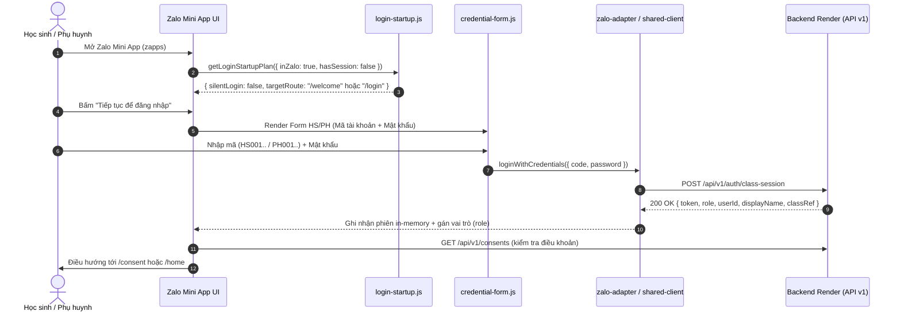

# Bàn giao Bản phát hành Zalo Mini App: Luồng Đăng nhập HS/PH (16/10/2026)

## 1. Mục tiêu và Quyết định của Huy

Theo yêu cầu chốt ngày 16/10/2026 của Huy:
- **Luồng hoạt động chính:** Zalo Mini App Family Bridge sử dụng luồng đăng nhập học sinh / phụ huynh (HS/PH) bằng **mã tài khoản + mật khẩu** trực tiếp bên trong môi trường Zalo.
- **Bảo tồn module Zalo cũ:** Toàn bộ implementation màn hình và nút "Đăng nhập bằng Zalo" cùng thẻ giải thích xác minh danh tính được giữ nguyên vẹn trong mã nguồn tại `zalo-mini-app/src/pages/login/legacy-zalo-login.js` để tái sử dụng trong tương lai.
- **Triệt tiêu đường truy cập màn Zalo cũ:** Bản phát hành hiện tại không có bất kỳ nút, liên kết, menu chuyển đổi phương thức, route router hay query parameter nào cho phép người dùng mở màn Zalo cũ. Cơ chế gating là compile-time (`LEGACY_ZALO_LOGIN_ENABLED = false`), không chỉ giấu bằng CSS.
- **Tắt silent login ngầm:** `src/core/login-startup.js` thiết lập `silentLogin: false` khi mở Mini App để người dùng chủ động trải nghiệm form HS/PH.
- **Ranh giới cô lập:** Tuyệt đối không thay đổi `web/**`, `packages/family_bridge_shared/**`, backend, database, Dockerfile hoặc cấu hình Render.

---

## 2. Kiến trúc và Đường dẫn Gọi (Call Path)

### 2.1. Luồng Xác thực HS/PH trong Zalo Mini App



### 2.2. Chi tiết các File Thay đổi

1. **`zalo-mini-app/src/pages/login/legacy-zalo-login.js` (Mới):**
   - Đóng gói toàn bộ component giao diện Zalo SDK cũ: tiêu đề, thẻ giải thích "Chúng tôi xác minh bạn như thế nào", nút "Đăng nhập bằng Zalo", xử lý `loginWithZaloToken()` và bắt lỗi.
   - Định nghĩa cờ compile-time: `export const LEGACY_ZALO_LOGIN_ENABLED = false;`.
2. **`zalo-mini-app/src/pages/login/index.js`:**
   - Loại bỏ nhánh rẽ mặc định mở Zalo SDK khi `isZaloHost()`.
   - Gated bằng `LEGACY_ZALO_LOGIN_ENABLED`. Mặc định gọi thẳng `renderCredentialLogin(...)`.
   - Form HS/PH hoạt động nhất quán cả khi chạy trong Zalo App lẫn khi chạy web test.
3. **`zalo-mini-app/src/core/login-startup.js`:**
   - Đặt `silentLogin: false` cho toàn bộ các case khi mở ứng dụng.
   - Bảo tồn logic điều kiện SDK cũ trong `getLegacyZaloSilentLoginCondition(...)` ở trạng thái dormant.
4. **`zalo-mini-app/src/pages/welcome/index.js`:**
   - Cập nhật nút kêu gọi hành động: Chuyển từ "Tiếp tục với Zalo" sang "Tiếp tục để đăng nhập" dẫn tới `#/login`.
5. **`zalo-mini-app/src/pages/how-to-use/index.js`:**
   - Cập nhật Bước 1 trong hướng dẫn: "Đăng nhập bằng mã tài khoản".
6. **`zalo-mini-app/tests/hs-ph-zalo-release.test.mjs` (Mới):**
   - Bộ kiểm thử riêng gồm 8 ca kiểm thử chuyên biệt:
     - Form HS/PH hiển thị trong Zalo host, không có nút Zalo.
     - Submit gọi đúng `loginWithCredentials`, tuyệt đối không gọi SDK.
     - Backend trả `zalo: true` vẫn ưu tiên giữ form HS/PH.
     - Thông báo trung thực khi `local_class` tắt hoặc gặp lỗi mạng.
     - Router không tồn tại route Zalo cũ.
     - Startup plan không silent login.
     - Module legacy được test độc lập và chạy đúng handler khi được gọi.

---

## 3. Chính sách Bảo tồn và Kích hoạt lại Module Zalo Cũ

Khi dự án được cấp quyền Official Account hoặc kích hoạt lại luồng Zalo SDK trong tương lai:
1. Mở file `zalo-mini-app/src/pages/login/legacy-zalo-login.js`.
2. Đổi giá trị:
   ```javascript
   export const LEGACY_ZALO_LOGIN_ENABLED = true;
   ```
3. Mở file `zalo-mini-app/src/core/login-startup.js`, kích hoạt lại `silentLogin`:
   ```javascript
   silentLogin: getLegacyZaloSilentLoginCondition({ inZalo, hasSession, manualLoginTest })
   ```
4. Build và kiểm thử lại với test suite hiện có.

---

## 4. Báo cáo Tuân thủ Ranh giới (Boundary Report)

- **`web/**`:** 0 file thay đổi.
- **`packages/family_bridge_shared/**`:** 0 file thay đổi.
- **`backend/**` / `render.yaml`:** 0 file thay đổi.
- **Mã nguồn Mini App:** Chỉ sửa đổi trong phạm vi được ủy quyền (`zalo-mini-app/**`).
- **Tài liệu:** Thêm mới độc lập trong `docs/handover/zalo-hs-ph-release/**`.
