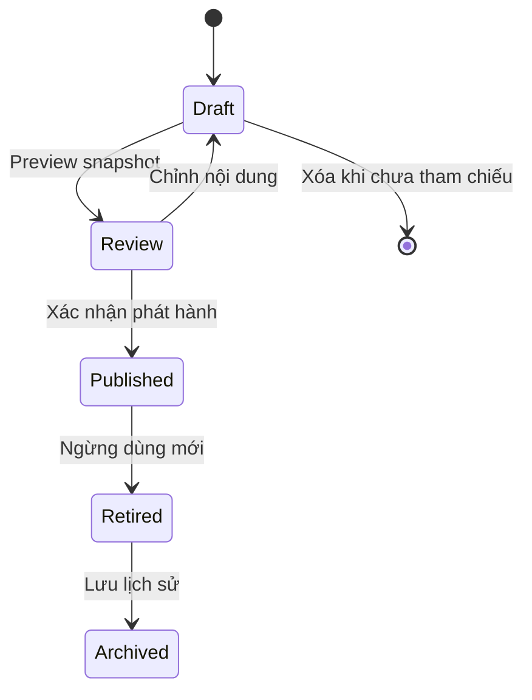

# Vòng đời nội dung và cấu hình

Hợp đồng cho AF-01..06, chưa implementation. [Catalog](admin-configuration-catalog.md) chỉ rõ từng field/effect; [states](workflow-state-machines.md) là guard register; [CAP](admin-capabilities.md), [acceptance](workflow-acceptance.md) và [decisions](decision-register.md) cùng nguồn. Mục lục: [state](#state), [publish](#phát-hành), [effects](#hiệu-lực-và-tham-chiếu), [rollback](#rollback), [concurrency](#concurrency-bulk-và-audit).

## State

Preview là render read-only của snapshot, không ghi consent/send. Review lưu revision/hash/actor/time/check results, có thể cùng người biên tập. Sửa bất kỳ field/references làm review invalid, quay Draft. Published immutable, sửa bằng clone revision mới; không Published -> Draft hoặc Archived -> Published trực tiếp. Retired là không dùng mới; Archived vẫn metadata lịch sử theo retention, không hard-delete record đang tham chiếu. Clone tạo logical content key/revision đúng loại; program clone giữ 4 weeks cùng baseline mục đích. Publication pointer chỉ là default mới, không migrate pin.

## Phát hành

1. Chọn loại/scope + capability; editor lưu typed draft, reason và expected revision. Scope/references phải đúng quyền, không nhận owner/reviewer/status published từ payload tùy ý.
2. Preview sát UI học sinh/người chăm sóc/admin, 320px/large text; so diff/version, kiểm tra wording/audience, nguồn và consent chuyên môn khi cần. Không live send trong preview. One-person review ghi rõ cùng actor; không tạo reviewer giả.
3. Validation server: 4 tuần ordinal 1..4, nội dung thiết yếu, IDs/references published hợp lệ, no cycles/duplicate ordering, limits từ catalog, assets allowlist, contrast/reduced motion, contacts consent/current verification, survey plan/pin/suppression, policy attestation. Validation gate nghiệp vụ bắt buộc ngay cả SYS.
4. Explicit confirm ghi displayed revision/hash, impact, reason. Backend reauth khi cần, transaction lock current revision và publication pointer, unique idempotency key + payload hash, immutable release + audit. Không network/provider trong lock.
5. Commit thành công mới cập nhật live pointer/public revision token. Invalidate public content cache theo release/scope; client refresh khi vào screen/resume. Data/private permission luôn recheck. Publication không phát sinh thư/consent hoặc notification ra Zalo.
6. Thiếu field/reference/role expired/stale: giữ draft, nêu lỗi gần field; no partial release. Mất mạng khi publish: tra status theo request key, không phát hành lần hai mù. Không tự xem optimistic UI là Published.

## Hiệu lực và tham chiếu

| Loại | Chính sách |
| --- | --- |
| Program/topic/activity/lesson/paper guide | Enrollment/activity pin content revision. Release mới chỉ lựa chọn mới; retired không nhận run mới. Người pin vẫn xem bản đã nhận nếu safe, với nhãn bản cũ. Nội dung nguy hiểm bị global safety withdrawal có reason; không âm thầm đổi pin, DEC-20 cần duyệt |
| Card/reply/group/pronoun templates | Picker mới dùng release đang active; message đã gửi giữ snapshot. Nháp đã chọn lưu content revision; trước send nếu retired/unsafe thì yêu cầu chọn/xem lại, không thay wording âm thầm |
| Journal prompts/agreement templates | Chỉ trang/đề xuất mới; bản riêng hoặc thỏa ước ký không đổi. Template là gợi ý, người viết sửa/duyệt |
| About/FAQ/onboarding | Public pointer release mới; không sửa bài viết gia đình hoặc auto-accept |
| Consent/privacy | Version riêng theo purpose/processing; record acceptance pin version cũ. Nếu thay điều kiện xử lý cần consent mới thì chặn riêng operation liên quan tới khi actor đồng ý; help và tính năng không phụ thuộc vẫn mở. Không xóa lịch sử withdraw |
| Directory/staff schedule | Live operational safety: số/consent/verification/availability recheck ở call/request/slot. Mục stale không phục hồi theo program pin; pending hẹn cần notice cho requester/assigned staff |
| Survey/form/cohort | Form referenced/published bất biến; response pin slot/form; clone không trộn pairing. Form có response không sửa questions/type/scoring âm thầm |
| Brand/config flags/quotas | Typed release mới áp theo catalog; rollback cũng release. Kill switch/revoke hiệu lực server ngay, không chỉ cache; data/nháp giữ nguyên theo policy |

## Rollback

Chọn release cũ -> clone thành Draft mới -> compare với live -> revalidate theo hiện tại -> preview/review -> publish revision mới ghi rollback_from và reason. Không rewind DB/history. Contacts đổi số/hết consent/review_due, user deleted, grant revoked và consent withdrawn không được hồi sinh. Survey/form có response không remap version; program rollback tạo default mới, enrollment giữ pin. Nếu rollback ảnh hưởng security/retention cần operator/owner theo quyết định đã chốt, không giảm policy floor. Nếu release cũ schema không còn compatible, cần coder; UI chỉ rõ không khả dụng.

## Concurrency, bulk và audit

Optimistic expected_revision/ETag ở edit; stale 409 theo hợp đồng đề xuất, giữ unsaved local text để compare, không overwrite. Publish khóa draft/review/pointer, quyền/scope recheck, idempotency một outcome; cùng key khác payload từ chối. Bulk chỉ hành động allowlist (retire/reorder/assign theo scope), preview danh sách IDs/count/impact, tối đa 50 mục/lô đề xuất DEC-17, explicit confirm. Không bulk hard-delete referenced hoặc family consent/send; ghi outcome từng mục, policy all-or-nothing cho nội dung release. Trộn scope/denied object không xử lý phần trái quyền. Recovery sau timeout đối chiếu request status; không auto retry destructive writes.

Audit append-only actor/role snapshot metadata, scope, target/revision, reason, before/after public diff hoặc hash, time/outcome. Private bodies/PII/credentials không diff/log. Thiếu audit persistence thì admin writes nhạy cảm fail-closed; help public vẫn mở. Retention/access backup/ledger quyết định ở DEC-12/18, không tự claim forever.
