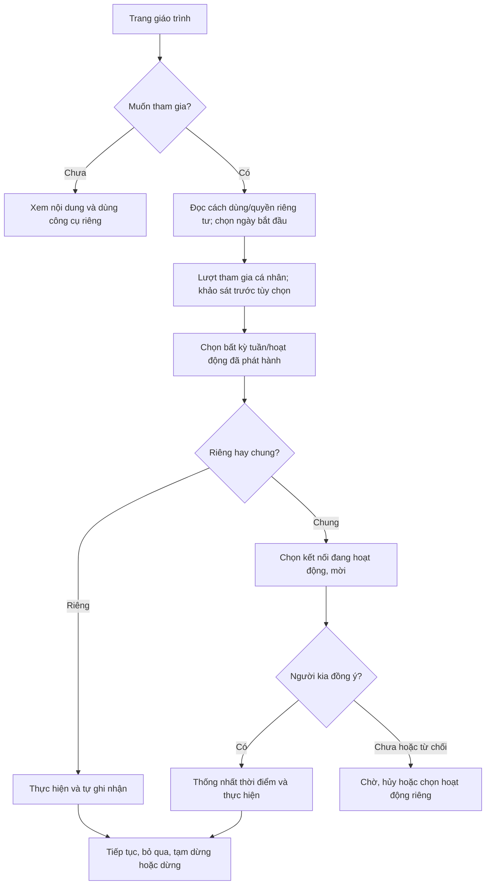
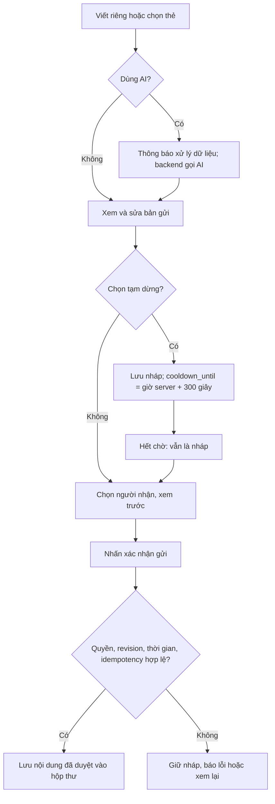
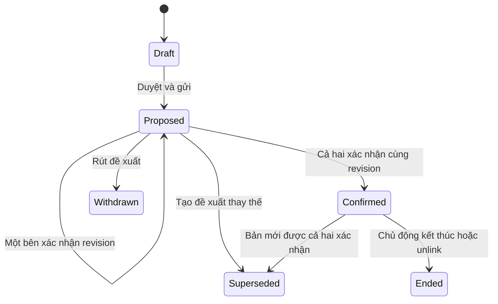

# Luồng chương trình đồng hành 4 tuần

Thiết kế Giải pháp 3 theo 15 tính năng đã chốt. Tên “can thiệp” không có nghĩa app chẩn đoán hoặc bảo đảm hiệu quả điều trị. Đây là thiết kế, chưa triển khai; liên quan US-036/044 và các US trong [phạm vi](../project-scope.md).

Mục lục: [nguyên tắc](#nguyên-tắc), [nội dung](#nội-dung-mỗi-tuần), [tham gia](#tham-gia), [hoạt động](#một-hoạt-động), [gửi](#diễn-đạt-và-gửi), [thỏa ước](#thỏa-ước), [trợ giúp](#trợ-giúp-và-lịch-hẹn), [nghiệm thu](#nghiệm-thu).

## Nguyên tắc

- Chương trình, từng hoạt động và khảo sát đều tự nguyện. Không thưởng/phạt theo cảm xúc, streak, mức chia sẻ hoặc phản hồi.
- Bốn tuần là lịch gợi ý từ ngày bắt đầu; mở mọi chủ đề đã phát hành, quay lại, bỏ qua, tạm dừng/dừng. Không khóa tuần sau.
- Mỗi người có lượt tham gia riêng; một người dừng không ép người kia dừng. Kết nối không cho phép đọc tiến độ riêng, mood/journal.
- Chưa kết nối vẫn dùng công cụ riêng, xem giáo trình và trợ giúp theo điều kiện truy cập. Hoạt động chung cần hai bên đồng ý.
- Chia sẻ chọn từng mục/người nhận, xem trước và xác nhận; hoàn thành hoạt động không tự gửi cảm nhận.

## Nội dung mỗi tuần

| Tuần / chủ đề | Học sinh | Người chăm sóc | Hoạt động chung tự chọn | Kết quả và quyền |
| --- | --- | --- | --- | --- |
| 1 — Nhận diện cảm xúc và “Tiếng lòng chưa nói” | Chọn mood/thẻ; viết điều buồn/khó mở lời; AI nếu muốn | Bài học 60 giây: nghe trước, không phán xét; viết cảm xúc của mình | Trò chuyện 5 phút, người nghe phản ánh điều nghe được | Mood/nháp riêng; chỉ thẻ/lời đã duyệt gửi cho người chọn |
| 2 — Giảm so sánh và “Bản sắc riêng của con” | Ghi cố gắng, sở thích, điều muốn được công nhận | Thay so sánh bằng ghi nhận cụ thể, luyện lắng nghe | Bữa ăn không điện thoại, đi dạo/gọi điện; nói điều trân trọng | Nhật ký riêng hoặc chia sẻ từng trang; không bắt phản hồi |
| 3 — Ranh giới riêng tư và niềm tin | Nêu ranh giới về không gian, điện thoại/thông tin riêng | Luyện hỏi trước khi xem/chia sẻ, nêu nhu cầu an tâm | Thảo luận điều đồng ý/chưa đồng ý, đề xuất ranh giới | Đề xuất chưa xác nhận; không ép cấp quyền xem điện thoại/journal |
| 4 — Cảm ơn, xin lỗi và “Thỏa ước gia đình mới” | Viết cảm ơn/xin lỗi với nhu cầu của mình | Phản hồi có trách nhiệm, nêu việc tiếp tục làm | Chọn 1–3 cam kết rõ ai làm/khi nào/cách xem lại; hai bên xác nhận | Thỏa ước có phiên bản và xác nhận từng người; khảo sát sau tùy chọn |

Activity có audience student/caregiver/joint, thời lượng dự kiến, hướng dẫn, câu hỏi và lựa chọn sổ giấy. Người phụ trách duyệt nội dung trước phát hành. Không tự đánh giá/chẩn đoán qua cảm xúc.

## Tham gia

Server xác minh Zalo trước lưu dữ liệu riêng. Kết nối qua mã mời, đủ thông tin nhận biết và xác nhận cả hai; không tự ghép vì cùng trường/số điện thoại. Tuần gợi ý tính ngày lịch theo timezone chọn (mặc định Asia/Ho_Chi_Minh); không dùng giờ client để cấp quyền. Sau ngày 28 vẫn xem lại được.

Enrollment: active -> paused -> active; active/paused -> completed khi người dùng chủ động kết thúc, hoặc -> withdrawn. Không tự completed sau 28 ngày, không đòi mọi activity done. Khảo sát sau gợi ý ngày 28 hoặc lúc kết thúc, cho phép bỏ qua; withdrawn không tiếp tục nhắc.

## Một hoạt động

Run riêng: planned -> in_progress -> done, hoặc skipped/cancelled. Làm lại tạo run mới. Ghi chú/trạng thái riêng chỉ actor xem.

Run chung: invited -> accepted hoặc declined/cancelled/expired. Sau accepted hai bên thống nhất giờ, thực hiện; mỗi participant xác nhận phần mình, run chỉ done khi cả hai xác nhận. Không có phản hồi thì giữ phần đã làm, không nhắc ép. Người nhận chỉ thấy lời mời và dữ liệu chung đã được người gửi duyệt, không thấy ghi chú riêng.

Một run chung có hai participant rows; enrollment mỗi người độc lập. Unlink chặn thao tác chung mới và hủy run chưa hoàn tất; bản ghi phần mình còn riêng, quyền đọc nội dung bên kia bị thu hồi theo [ERD](../data/erd.md).

## Diễn đạt và gửi

Pause là lựa chọn khi soạn; khi đã chọn server chặn gửi nháp đó trước cooldown_until. Sửa cập nhật revision, không bỏ qua thời gian còn lại; bắt đầu lại 300 giây chỉ do người viết chủ động chọn. Hết giờ/AI/resume/retry mạng/thiếu phản hồi không gửi. Đổi nội dung hoặc người nhận sau preview phải xem và xác nhận đúng revision.

AI original/suggestion thuộc nháp riêng. Message chỉ snapshot người viết duyệt; không prompt, câu gốc hoặc link đọc nháp. Phản hồi nhanh tùy cách xưng hô: “Đã đọc”, “Mình muốn nghe bạn”, hẹn giờ; người nhận sửa được. Read receipt không có nghĩa nhu cầu đã được giải quyết.

Chia sẻ mood/journal dùng grant từng mục, không âm thầm tạo bản sao nội dung trong message. Revoke chặn đọc mới và xóa preview cache trong app; không hứa thu hồi ảnh chụp ngoài app.

## Thỏa ước

Sửa tạo revision mới, bắt đầu lại xác nhận; không sửa chữ bản đã xác nhận. Bản confirmed cũ vẫn áp dụng đến khi bản mới confirmed hoặc chủ động kết thúc. Hai bên có thể đọc cam kết đang chia sẻ; không có hiệu lực pháp lý được tuyên bố. Unlink chặn cập nhật chung và quyền nội dung bên kia, không dùng thỏa ước cấp quyền xem nhật ký.

## Trợ giúp và lịch hẹn

- “Con cần được lắng nghe”: chọn người đang kết nối, nhu cầu và xác nhận; tín hiệu thông thường, không gửi cả danh bạ.
- Chưa phản hồi: người dùng chủ động chọn điểm tựa đã đồng ý và tạo yêu cầu mới, không tự chuyển tin cũ/AI original.
- Trang trợ giúp độc lập nháp/timer/chương trình: số/giờ đã xác minh, người dùng mở màn hình gọi. Có bản danh bạ công khai tối thiểu đã duyệt khi auth/API lỗi; không kèm dữ liệu riêng. Bấm gọi không chứng minh đã kết nối cuộc gọi.
- Hẹn thầy/cô chỉ bật khi staff nhận vai trò, school scope, lịch hoạt động. Staff nhận đúng request, chấp nhận/đề xuất giờ; học sinh xác nhận. Có từ chối/hủy/lịch trùng/đầu mối ngừng hỗ trợ; vẫn còn số điện thoại/trợ giúp.

## Nghiệm thu

| Tình huống | Kết quả |
| --- | --- |
| Bỏ tuần 1, mở tuần 3 | Mở nội dung đã phát hành bình thường |
| Bỏ khảo sát | Không mất quyền dùng app/chương trình |
| Từ chối run chung | Không forced run, không lộ ghi chú riêng |
| AI lỗi/hết timer ở nền | Nháp còn, không message mới |
| Gửi hai lần cùng key | Một message; khác payload cùng key bị từ chối |
| Unlink đồng thời gửi/xác nhận | Transaction kiểm tra lại, không gửi/cấp grant sau revoke |
| Sửa thỏa ước sau một bên xác nhận | Revision mới cần cả hai xác nhận lại |
| Admin xem tiến độ riêng/journal/AI | Từ chối; chỉ tổng hợp được phép |
| Không staff/API lỗi | Không hứa lịch tự động; còn danh bạ trợ giúp |

Liên kết: [ERD](../data/erd.md), [admin](admin-capabilities.md), [DSA](../engineering/dsa-rules.md). Thiết kế không chứng minh đã nghiệm thu.

## Liên kết workflow/admin thống nhất

Bản này giữ baseline 4 chủ đề và tóm tắt chương trình. [FL-12..15 và các luồng khác](user-flows.md), [state register](workflow-state-machines.md), [catalog A/C](admin-configuration-catalog.md), [lifecycle](content-lifecycle.md), [WF rules](../engineering/workflow-rules.md) và [acceptance](workflow-acceptance.md) chi tiết guards/lỗi/offline/concurrency/expected. Nhãn `planned/done` ở run tương ứng `not_started/completed` diễn giải UI; schema enum phải chốt US-004, không tạo hai state machine. Enrollment có completed tự chọn, không tự kết thúc ngày28. Agreement confirmed cũ áp dụng đến revision mới confirmed hoặc chủ động end/unlink; chỉnh proposal mới không sửa bản cũ.

Admin clone version, sửa wording/mục tiêu phù hợp baseline/hoạt động/audience/lesson/paper guide rồi preview/review/publish; người đang tham gia pin phiên bản, không rewrite riêng tư/confirmed agreement. Cùng người có caps được review/publish bước riêng, chuyên môn/legal vẫn approval thật. Không đổi số tuần/phạm vi nghiên cứu, pause300 hoặc auto-send. Retirement safety tác động pin cũ cần policy DEC-20, alternative/help; contact current safety luôn recheck dù program pin. Module off không xóa nháp/ghi chú. Xem [handover](../operations/admin-handover.md) và [decisions](decision-register.md) trước phát hành/pilot.
