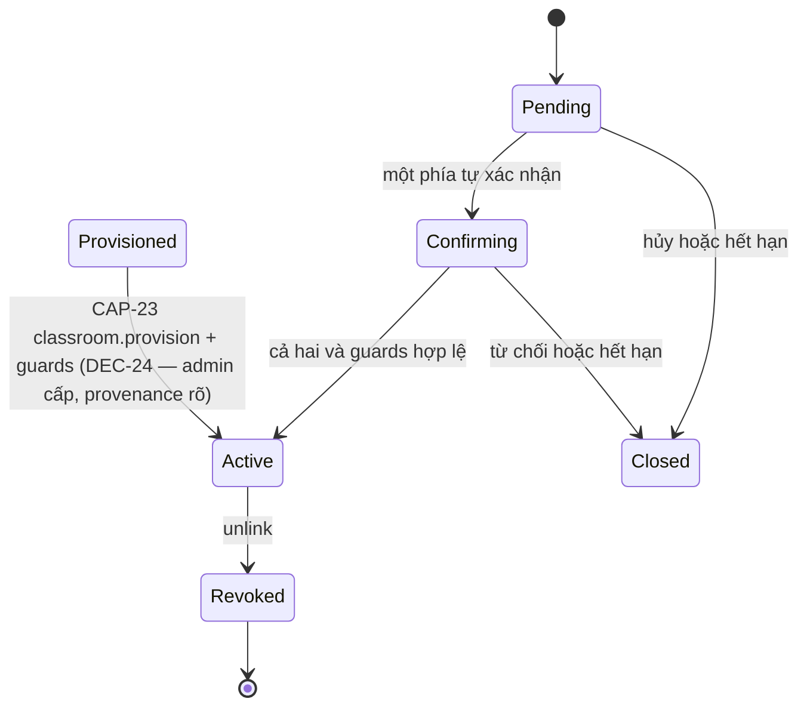
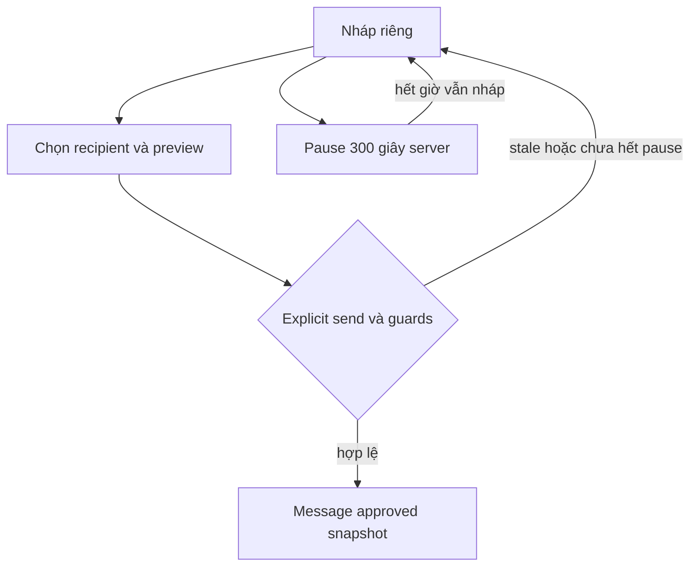
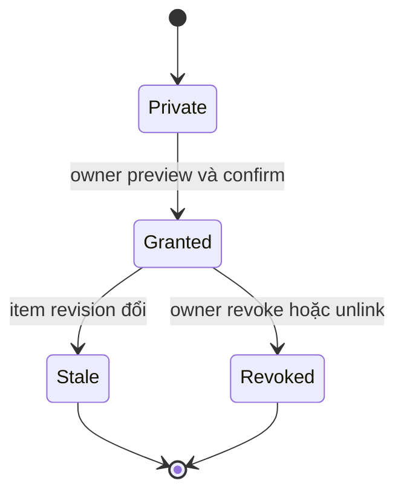
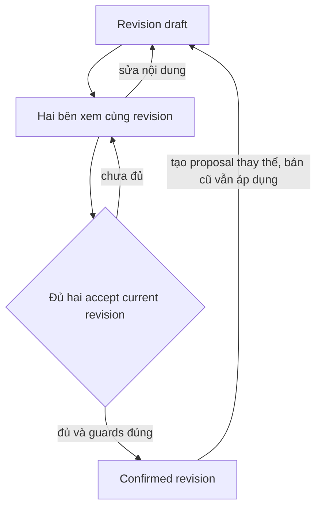
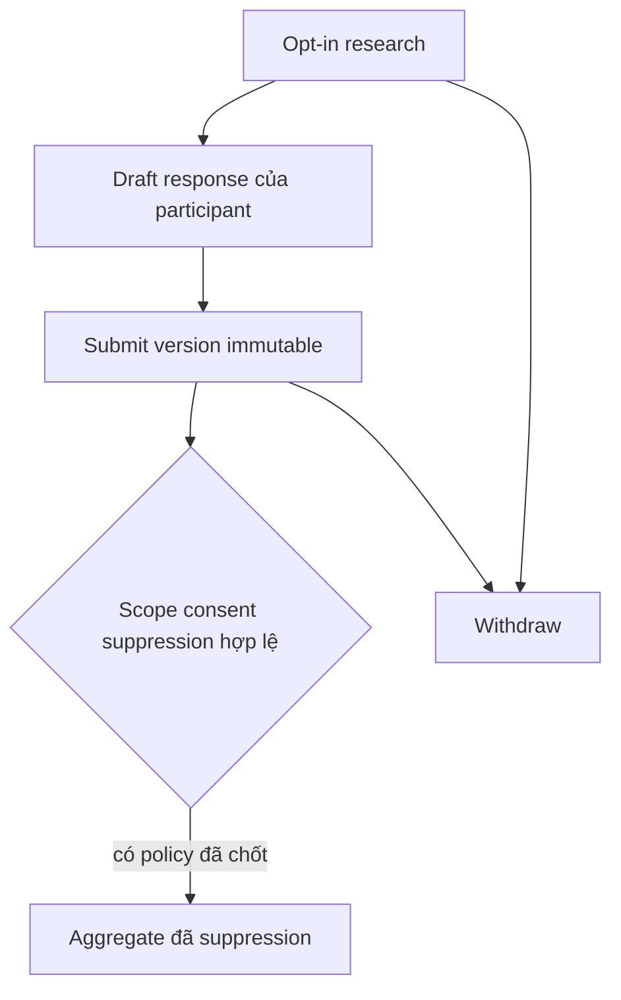
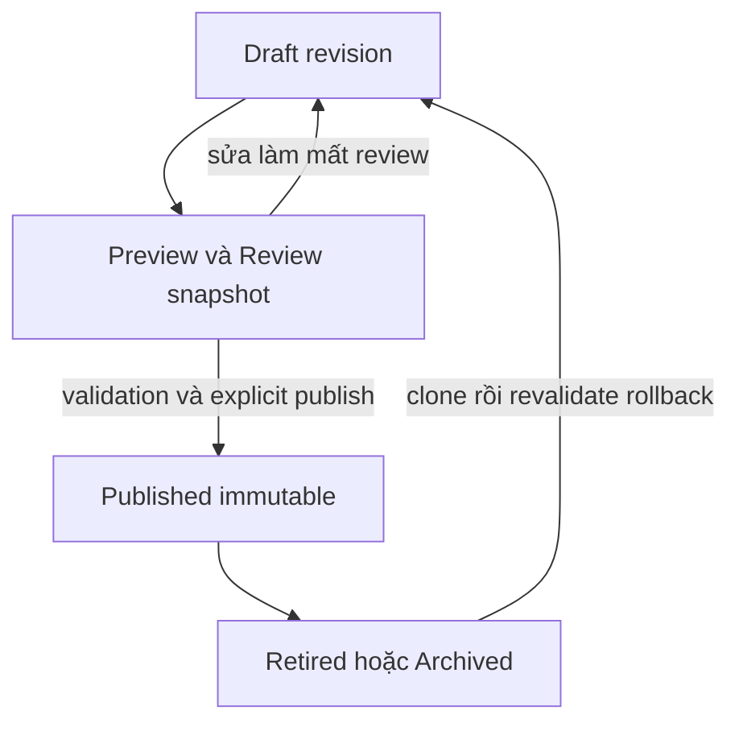

# State machines và guards

Hợp đồng thiết kế cho [FL/AF](user-flows.md), không enum/model đã chạy. Các nhãn dưới đây mô tả **state nghiệp vụ**, serializer/schema thật phải được chốt US-004; không tự thêm field/migration từ sơ đồ. [ERD](../data/erd.md) giữ entity/reference; [WF](../engineering/workflow-rules.md), [acceptance](workflow-acceptance.md), [lifecycle](content-lifecycle.md) giữ invariant và expected result. State UI `outcome_unknown` là trạng thái đối soát, không kết luận DB đã thất bại.

## Guards chung cho mọi transition

Backend MUST đọc principal/session và scope/capability/current object/state/revision trong cùng ranh giới transaction phù hợp. Permission guard chạy trước đọc body, phân trang, đếm, export, mutation. Grant luôn đúng item/recipient/revision/connection generation. Mutation sensitive có step-up đã được chốt, lý do, minimal audit durable; request key + payload hash không thay quyền hiện hành. Lock theo thứ tự thống nhất, unique DB là lớp cuối; network/AI/provider ngoài transaction. Retry không đổi key nếu outcome chưa rõ. Không `is_staff`, client flag, superuser data bypass.

Mọi row dưới đây kế thừa các guard này. Từ chối/hủy/hết hạn chỉ chuyển tới state tương ứng, không thành accepted/sent. Offline không tạo server transition; resume refresh current state/quyền. 409 trả current_revision an toàn và lựa chọn reload, không tự merge acceptance. Revoke là terminal cho grant/generation đó; reconnect/rollback không mở lại. Help luôn ngoài cooldown và error gate sản phẩm.

## User transition register

| Flow / aggregate | Transitions hợp lệ và người thực hiện | Guard bổ sung | Forbidden / xử lý khi race |
| --- | --- | --- | --- |
| FL-01 / session, consent | Anonymous → authenticated qua provider verified; actor tự accepted/declined/withdrawn từng purpose/version; logout revoke session | App ID, principal binding, policy_version chính xác, actor hợp lệ | Login không accepted consent; admin không ký; policy đổi cần xem lại; stale version409 |
| FL-02 / main connection | Invite created → candidate → awaiting_confirmation → active; từng phía confirm; decline/cancel/expire trước active | Hash/TTL, không self, canonical pair unique; cả hai tự confirm cùng invite, generation hiện tại | Một phía/admin confirm thay không active; revoke race chặn activation; mã hết hạn không hồi sinh |
| FL-02P / provisioned connection (18/10/2026 — DEC-24/WF-25) | Admin có CAP-23 `classroom.provision` LƯU cặp HS↔PH → Provisioned → ACTIVE ngay (không qua invite/proposal); hoặc backfill chuyển cặp đang chờ sang ACTIVE | Scope lọc thật (global/school=class_ref), canonical pair unique, generation mới, provenance `source=admin_provisioned` + batch_ref, audit batch | Không active lại cặp đã revoke nếu không tick chủ ý; không nhân đôi khi nạp lại; không sinh consent/grant kèm |
| FL-03 / backup connection | Cùng transitions FL-02; kind backup | Bounds quan hệ, recipient được user chọn ở action gửi | Không timeout→backup/auto-forward; kind change không rộng quyền, reconnect generation mới |
| FL-04 / MoodEntry | Absent → saved → updated(revision tăng); owner delete theo FL-20 | Unique owner+logical_date, timezone không rewrite ngày cũ | Không saved→shared ngầm; concurrent update409 không overwrite |
| FL-05 / MoodShare | Private → grant_active → revoked/stale; grant mới qua preview/confirm | Own item + active recipient + approved_revision=current + generation | Stale grant không đọc historical body; sửa mood làm stale, reshare explicit |
| FL-06 / JournalPage | New → draft → saved → updated hoặc deletion_pending | Owner-only, bounds text, expected revision | Không mẫu publish→rewrite page; admin/family edit/read denied |
| FL-07 / JournalShare | Private → grant_active → revoked/stale; reply Message mới qua FL-11 | Current page/revision/generation + recipient; reply_context còn quyền | “Song hành” không share cả nhật ký, không reciprocal grant; revoke trước reply chặn |
| FL-08 / draft & message | Editing → previewed → sending → sent; sending → outcome_unknown UI → lookup sent hoặc còn draft | Preview hash bind body/recipient/revision, cooldown, current connection, idempotency/unique | Edit làm mất preview; timer/retry/network không send; same key different payload409 |
| FL-09 / AI operation | Idle → generating → suggested/error/cancelled; suggested → applied hoặc discarded | Consent AI, provider/budget/limits; apply input_revision còn current | Stale/output invalid không overwrite; no auto-send; revoke/kill switch chặn apply |
| FL-10 / pause | Editable → paused đến server_time+300 → eligible draft | Pause tự chọn; edit không rút deadline; send guard server_now | Eligible không sent; clock client không bypass; help không qua pause |
| FL-11 / Message/read | Sent → read bằng recipient thực sự mở; reply là message mới | Current scope/generation/context; read event idempotent | Read không hiểu/đồng ý/resolved; SYS không universal inbox; reconnect không old generation |
| FL-12 / Enrollment | Offered → active → paused → active; active/paused → completed do owner tự kết thúc, hoặc withdrawn | Voluntary, ProgramVersion published pin; các tuần truy cập không khóa | New publish không migrate pin; nghiên cứu không suy từ enrollment; withdrawal không phạt |
| FL-13 / solo run | Not_started → in_progress → completed/skipped/cancelled | Owner, audience/published ref pin, explicit finish | Time open không complete; note không share; retire unsafe có alternative |
| FL-14 / joint run | Invited → accepted/declined/expired; accepted → in_progress; mỗi participant completed/cancelled | Từng actor tự quyết định, unique participant, content/generation current | Một actor không accept/complete thay, private_note không chung; revoke chặn action chung |
| FL-15 / agreement | Draft → awaiting_acceptance → confirmed cùng revision; edit tạo pending replacement revision/awaiting_acceptance, confirmed cũ áp dụng đến bản mới confirmed hoặc end/unlink; withdraw/supersede | Hai unique signers tự accept current revision, current connection | Accept v1+v2 không confirmed; template/admin không ký; edit+accept transaction409 |
| FL-16 / listening signal | Composing → previewed → sent/read như FL-08, nhưng không pause | Recipient user chọn, active; help alternative nếu unavailable | Không no_reply→forward/escalation; admin không send thay |
| FL-17 / directory | Draft/verified_active → outside_hours/suspended/retired theo live safety; call user mở OS | Consent/verification/review_due, giờ/timezone, current contact | Tap call không completed care; auth/AI lỗi không block help; stale số không promise |
| FL-18 / appointment | Requested → accepted/declined/reschedule_proposed; requester confirm current time → confirmed; cancel/expire; assigned staff mark completed theo thực tế | Actual accepting staff, scoped assignment, capacity/time lock, revision; giờ UTC + display timezone | SYS chưa assigned không note; changed time không auto-confirm; overlap 409; reassignment revoke staff cũ |
| FL-19 / participation & response | Not_participating → consented → draft response → submitted; consented/submitted → withdrawn | Phase/audience/cohort/version/consent, unique slot, typed answers; report policy đã chốt | Submitted immutable; version mới không edit response; raw/mapping/admin API không; suppression không bypass |
| FL-20 / privacy | Grant/connection/consent active → revoked/withdrawn; deletion requested → verified → processing → completed/failed_needs_action, hoặc rejected có căn cứ | Scope owner, durable ledger, worker authorized, outcome thật | Revoked terminal, reconnect mới không revive; partial deletion không completed, restore không undo |

## Admin transition register

| Flow | Transitions / guards riêng | Không được phép / race |
| --- | --- | --- |
| AF-01 / content, policy, brand | Draft → Preview/Review snapshot → Published immutable → Retired → Archived; edit trong review trở Draft; clone rollback tạo release mới | Direct publish bỏ review; published edit/hard delete; stale review hash; unique release + expected pointer, duplicate key một release |
| AF-02 / directory & scheduling | Draft→verified_active khi consent/verify/approval đủ; safety suspend ngay có audit; assign revision + CAP đúng scope | Unverified publish, revive old phone, staff cũ read note; no slot capacity violation; replace confirmed time không user confirm |
| AF-03 / survey & aggregate | Draft→review→published/frozen; retire; report chỉ current policy/consent/scope, version group riêng | Modify referenced question/options, free SQL scoring, raw export, k unset/lower floor, overlapping query làm lộ cá nhân |
| AF-04 / role/account | Invite→accepted/expired/cancelled; grant→active→revoked/expired; lock→restricted→restored bởi case hợp lệ | Self-elevate, SCHOOL→SYSTEM ngầm, last viable SYSTEM owner lock/revoke race, fake recovery/step-up, restore old grant |
| AF-05 / config | Typed draft→review→published; kill switch off lập tức có audit + impact; flags chỉ implemented module | Help off, pause≠300, auto_send=true, arbitrary code/URL/secret, enable absent module; expected config revision409 |
| AF-06 / operations | Privacy case requested→verified→processing→completed/failed_needs_action hoặc rejected có căn cứ; restore requested→isolated→ledger_applied→validated→serving | Serving trước latest ledger/checkpoint; full DB button; false completed; sensitive mutation nếu audit unavailable failclosed |

## Sơ đồ nhỏ theo nghiệp vụ

### Hai bên kết nối (FL-02/03)

Mỗi reconnect bắt đầu Pending với generation mới, không Revoked→Active. Closed không reveal danh tính cho người dò mã.

### Soạn và gửi (FL-08/10/16)

Tín hiệu/help không qua T. AI chỉ sửa D theo revision, không nối đến S. Gửi không rõ kết quả phải lookup operation trước retry.

### Grant theo một revision (FL-05/07/20)

Reshare tạo grant revision mới sau preview cho revision/current generation mới; baseline có thể update cùng UNIQUE(item,recipient) row với metadata audit như ERD, không bật quyền grant revision terminal cũ.

### Thỏa ước (FL-15)

### Khảo sát (FL-19/AF-03)

W invalidate report/cache; chưa chốt DEC-15 thì không có output A. Không edge tới raw admin view.

### Nội dung (AF-01)

Preview khác Reviewed receipt: xem màn hình không tự phê duyệt. Same actor được review/publish nếu có đủ capability; chuyên môn/legal vẫn cần approval thật. Sơ đồ tổng quát không thay state/guard table hay API contract.
