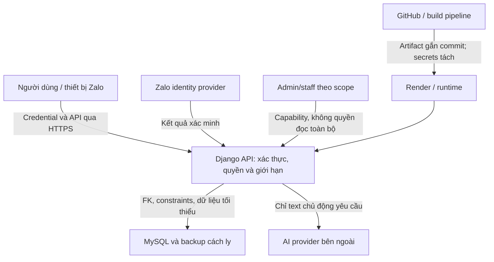

# Mô hình đe dọa Family Bridge

Bản thiết kế 10/10/2026; cập nhật khi thay auth, storage, quyền, AI/provider, trường, export hoặc deployment. Các rủi ro là giả thuyết cần xử lý, không khẳng định có lỗ hổng đã khai thác.

## Tài sản và ranh giới

Tài sản: danh tính Zalo/binding, session/keys, kết nối/consent, nhật ký/mood/nháp AI, message đã duyệt, lịch hẹn, survey raw/mapping, báo cáo tổng hợp, public danh bạ, backup và release artifact.

Client/role flags/timestamp/IDs/user text/AI output/third-party response không tin cậy. Network nội bộ không tự chứng minh actor được phép. Server/operator và AI provider có xử lý kỹ thuật; không có E2EE được triển khai. Backup là một ranh giới quyền/retention riêng, không bản sao tùy ý.

## Actor và abuse cases

| Actor / điểm vào | Rủi ro cụ thể | Kiểm soát |
| --- | --- | --- |
| Người lạ / login và invite | Giả Zalo ID, dò mã, enumeration, replay | SEC-01/02/06/14 |
| Người đã kết nối | Đọc mọi journal/mood, giữ grant sau unlink, ép gửi/đổi người nhận | SEC-03/05/07/08/15 |
| Người dùng khác | Đổi object/recipient/school ID để truy cập chéo | SEC-03/04/05 |
| Người dùng gửi nội dung độc hại | Stored XSS, SQL/command injection, Unicode/big body, URLs | SEC-11/12/13/14 |
| Staff/admin phạm vi hạn chế | Nâng quyền, xuất raw surveys, xem tâm sự trường khác | SEC-04/05/22/23/26 |
| Client bị can thiệp hoặc account bị chiếm | Lộ token, stale session, send retry/double submit | SEC-02/07/10/15 |
| Bot / API/AI | Spam invite/thư/hẹn, vét quota AI, làm đầy DB/worker | SEC-06/14/15/16 |
| Prompt/AI provider | Lộ original/PII, đổi ý, trả HTML, auto-action | SEC-05/12/16/17/18 |
| Dependency/CI compromise | Build cài code độc, artifact thay đổi, lấy secret | SEC-19/25/26 |
| Cấu hình cloud / DB | Public MySQL, proxy spoofing, DEBUG, secret health/log | SEC-09/19/20/27 |
| Research export | Pseudonym bị join lại, nhóm nhỏ/diff inference | SEC-23 |
| Hỏng DB/provider/runtime | Mất dữ liệu, restore quyền đã thu hồi, trợ giúp bị chặn | SEC-18/21/24/27/28 |

## Rủi ro cần ưu tiên

P0 trước thử dữ liệu thật: xác thực/binding, object/property/admin ACL, token/secret handling, consent/sharing, no-auto-send, quota/resource controls, log minimization và backup/restore/delete policy. P1 trước phát hành rộng: threat review provider/SDK, suppression/report/export, hardened pipeline/monitoring, abuse/incident drills. Đây là thứ tự triển khai, không miễn P1 nếu pilot đã dùng tính năng tương ứng.

Không đưa private nội dung vào telemetry, analytics, crash screenshots hoặc notification preview. Số điện thoại/giờ contact phải đúng và được đồng ý; content/admin compromise có thể hướng học sinh đến đầu mối giả, nên publish cần kiểm soát tương đương code release.

## Giới hạn và quyết định còn mở

Không chống hoàn toàn thiết bị root, screenshot, tài khoản Zalo bị chiếm hoặc operator/provider độc hại. Phải giảm dữ liệu/đặc quyền và mô tả thật cho người dùng. Chốt refresh/step-up cơ chế Zalo, retention/provider processing, tin lịch sử sau unlink, ngưỡng báo cáo, quy trình trường và budget/rate limit trước kiểm thử tính năng tương ứng. Không triển khai biometric/device attestation/pinning trong JS nếu Zalo platform không hỗ trợ; dùng MASVS để đánh giá phần mình kiểm soát.
